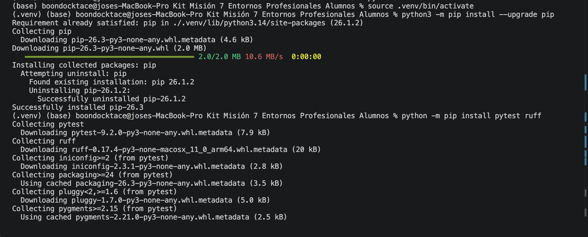
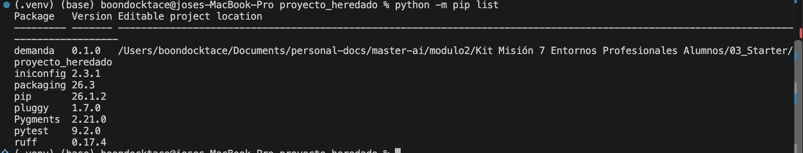
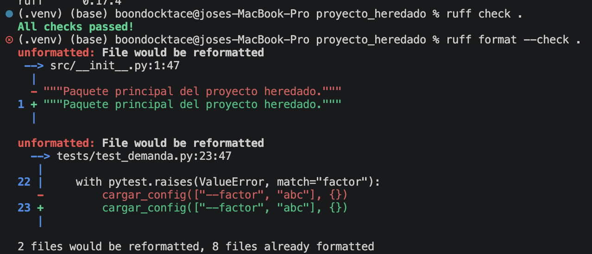
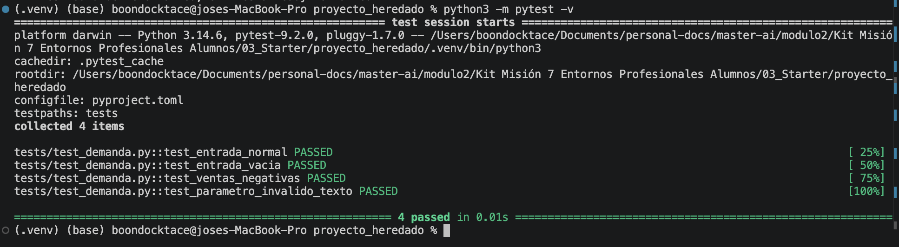

# Evidencias — pareja: 

Jose Matias Gonzalez Valarezo

Sarah Benedi Adams

## Diagnóstico

Con el `ventas.csv` entregado y desde su propia carpeta, `python app.py` funciona y muestra `Demanda prevista: 22.0`. Los problemas aparecen al cambiar los datos del csv.

Los fallos se reprodujeron con Python 3.14.6 sobre el `app.py` original, salvo los marcados como "lectura del código". Ese archivo está disponible en el commit inicial del repositorio (`cb4eef2`), y las referencias a sus líneas son a esa versión.

## Entorno

Python: 3.14.6 · intérprete VS Code: comando de instalación: `python -m pip install -r requirements.txt` y `python -m pip list`.

## Calidad

Resultado `ruff check .`: `All checks passed!` · `ruff format --check .`

## Pruebas

Casos implementados: los cuatro obligatorios, en `tests/test_demanda.py`:

| Caso obligatorio | Prueba |
|---|---|
| Normal | `test_entrada_normal` |
| Vacío | `test_entrada_vacia` |
| Negativos | `test_ventas_negativas` |
| Parámetro inválido | `test_parametro_invalido_texto` |

Resultado `pytest -v`: `4 passed`

## Transferencia

Otra pareja: **PENDIENTE** · ¿instaló sin ayuda?: **PENDIENTE** · incidencias y cambios: **PENDIENTE**

Comprobación previa propia, que no sustituye a la prueba con otra pareja: copia limpia solo con los archivos que no ignora Git, entorno nuevo y comandos del README en macOS con Python 3.10.22, 3.11.18 y 3.14.6. En las tres versiones se obtuvo `4 passed`, Ruff sin errores y `Demanda prevista: 22.00` desde otra carpeta. Los comandos de Windows no se han probado.

## Colaboración

Enlace repositorio/PR: https://github.com/Boondock19/modulo2-mision7 

## Uso de IA

Herramienta: Claude Code.

Finalidad: repasar comandos de entorno y Git, evaluar el diagnóstico inicial, y generar el código, las pruebas y la documentación de este repositorio.

Fragmentos revisados y comprobaciones propias: Ambos realizamos la revision cruzada sobre el codigo generado por el otro para tener dos revisiones sobre cada codigo.
